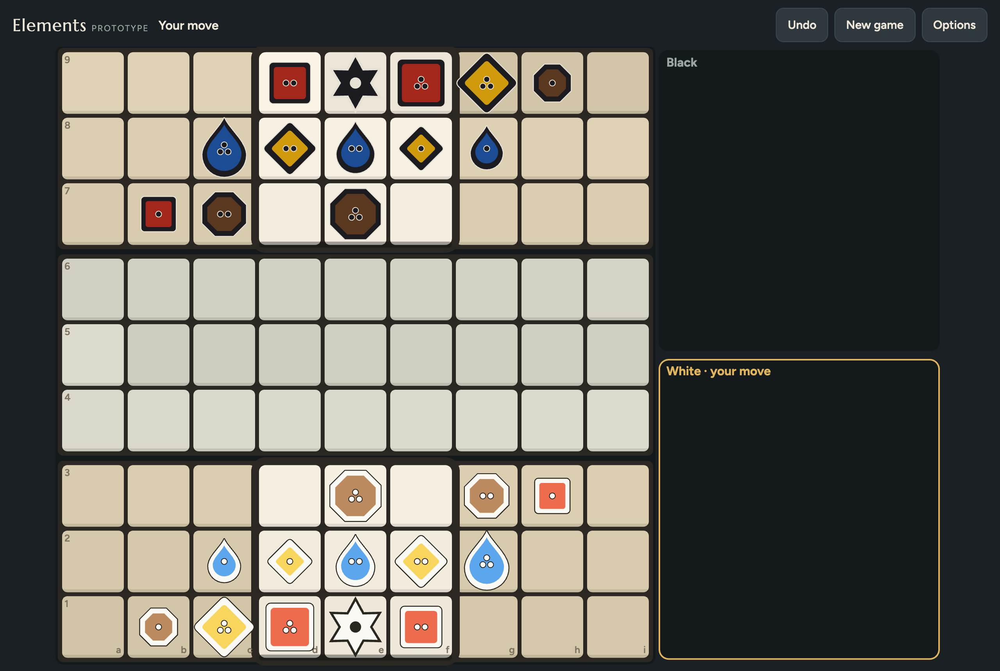
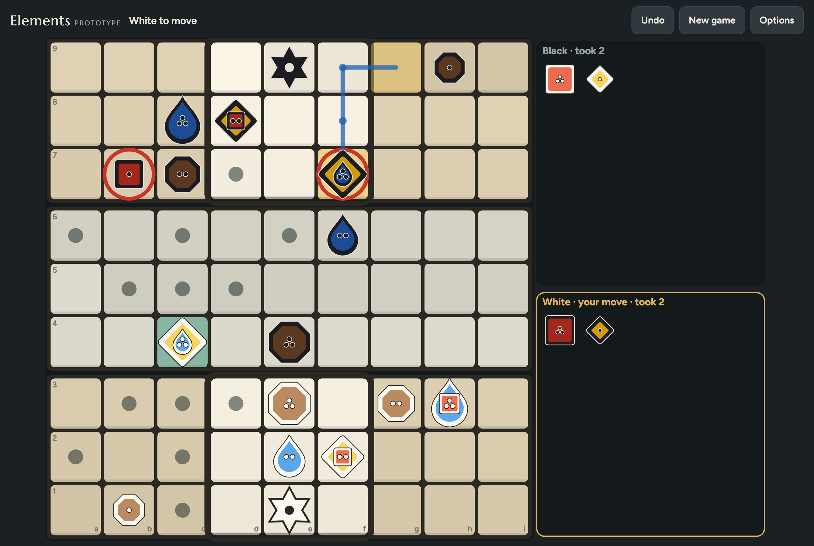
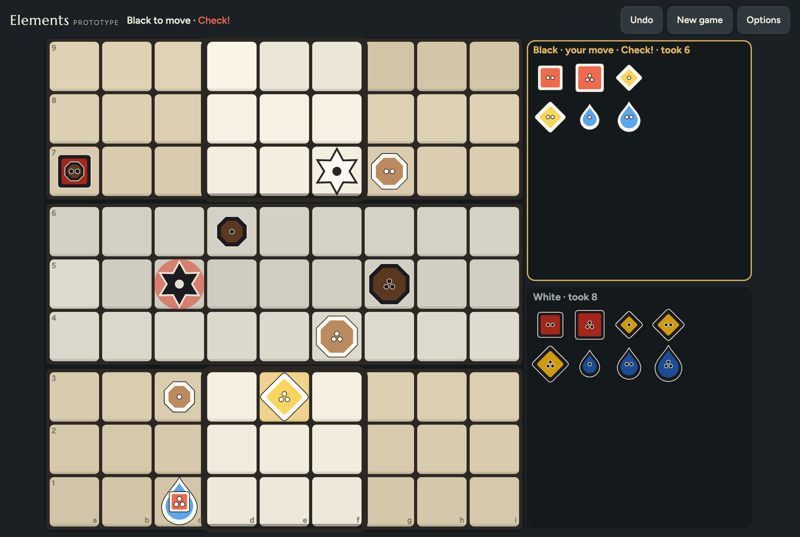
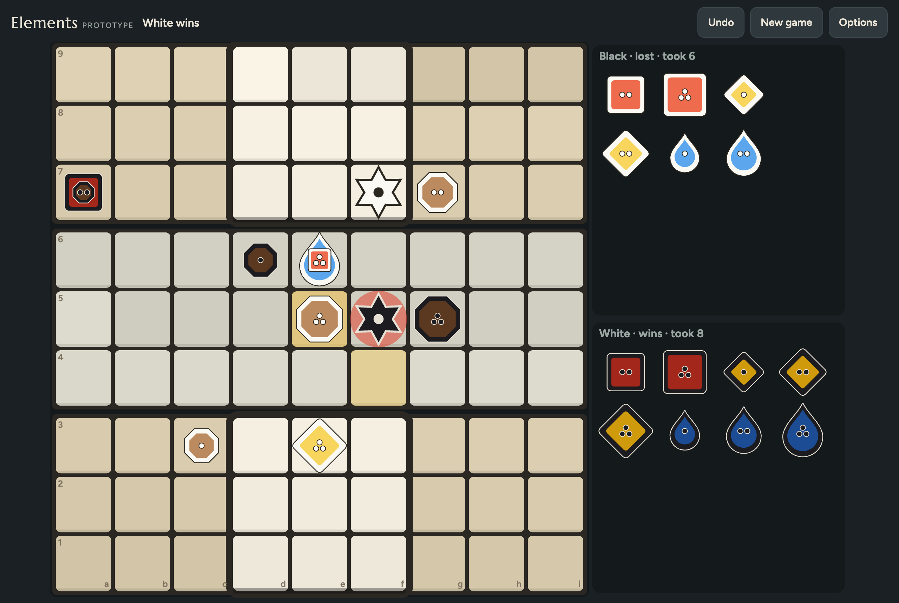

# Elements

A digital version of **Elements**, a two-player abstract strategy game I designed. Fire, Wind, Earth and Water pieces and a Wizard on a 9×9 board, with no dice and nothing hidden. The goal is to play it with friends on iPad and iPhone first, then on Android and the web.

You can already play the prototype against the computer: https://elements-game-kappa.vercel.app



The game itself isn't licensed for reuse. All rights reserved.

## How it plays

Each player has 13 pieces: a Wizard, plus Fire, Wind, Earth and Water in sizes 1, 2 and 3. A piece's size is how far it can move, and nothing jumps over other pieces.

- **Fire** moves along rows and columns.
- **Wind** moves diagonally.
- **Earth** moves in any direction, but it can't capture and can't be captured. Its job is to block lines of attack.
- **Water** flows straight forward or back along its column. Next to an Earth piece (yours or your opponent's) it can bend diagonally around it, and it can slide along the edge of the board.
- **The Wizard** moves one square in any direction, like a king in chess.

You capture by landing on an enemy piece. Size doesn't matter in a fight, so a Water 1 can take a Fire 3.

You can also move a piece onto one of your own to **combine** them. A stack moves as either element (one kind of move per turn) with the larger of the two ranges, but if it's captured you lose both. Earth in a stack loses its protection and fights as the other element, which gives you a way back into a game after you've lost your attackers.



*White's Wind + Water stack on c4 is selected. As Wind it can take Black's stack on f7. As Water it can flow up the c-file and bend around Black's Earth on c7 to take the Fire on b7.*

Before the game, each player builds a formation in the three rows nearest them. The app comes with preset formations, so you can start right away. You win by checkmating the other Wizard or by capturing all of their attacking pieces (everything except plain Earth).

The middle 3×3 of each home zone is a **castle**. If your Wizard gets into the enemy castle, it can bring back one of your captured pieces into your own castle instead of moving. This rule came out of playtesting, as a fix for endgames that stalled into draws.



*White's Wizard has walked into Black's castle (f7) and brought back its captured Wind 3 onto e3, which puts Black in check.*



*Checkmate. White's Earth steps from f4 to e5, and the Water + Fire stack on e6 can now bend around it onto Black's Wizard.*

The full rules, with the reasons behind each decision, are in [GAME_SPEC.md](GAME_SPEC.md).

## Playtesting with computer players

Before asking people to test every rule change, I had the computer play. [playtest/](playtest/) has bots ranging from random moves up to Deep, a search player built from chess-engine techniques with piece values learned from 8,000 games. They've played about 216,000 games so far.

Most of the numbers below come from Deep playing against itself under the current rules, starting from the default formation. The skill and play-style rows use the simpler bots.

### Balance

| Question | Result |
|---|---|
| Does moving first win? | Barely. White wins 47–52% of decided games between equal bots. The same bots score 48% with White at chess. |
| Does skill matter? | A lot. Each bot that looks further ahead beat the one below it 92–99% of the time. In the prototype, Easy lost all 400 of its games against Medium and Hard. |
| Does every piece pull its weight? | Start a side without one piece and it scores 15% without Wind 3, 20% without Water 3, 24% without Fire 3, 28–34% without a size-2 piece and 42% without Fire 1. Every attacking piece counts, the big ones most. Missing an Earth costs nothing on its own. |
| Is there one way to play that always wins? | No. Against a standard bot, a bot that hunts the Wizard scores 43%, hiding behind Earth 37%, rushing 30% and never combining 17%. Combining a lot is the strongest habit (71%), which is how it should be, since combining is the heart of the game. |
| Does the formation decide the game? | Not much. The presets are within about 100 rating points of each other, so the best one would score about 64% against the weakest. |

### Playability

| Question | Result |
|---|---|
| Do games end? | Always, with no endless loops. A typical game takes 45–55 moves each. |
| How are games won? | 52% by checkmate, 38% by capturing all attackers and about 10% are drawn, so both ways to win matter. |
| How often is it a draw? | 7–10% of games under the current rules. The same bots draw 10% at chess. Before the castle return it was up to a third. |
| Can you come back from behind? | Yes. In 36% of decided games the winner had been a whole element down at some point. One element up wins 61% of the time, two up 78% and three up 91%. |
| Does the castle return get used? | Pieces come back in 29% of games. A bot that never walks its Wizard to the enemy castle scores only 39–42%, so it's a real plan and not a gimmick. |
| Does Earth's comeback work? | A piece down, being allowed to combine Earth lifts the score from 26% to 30% (Fire 2 missing) and from 12% to 19% (Water 3 missing). |

### What changed because of it

- **Water came out strongest** and gave most of the checkmates. After I also found its attacks hard to see at the table, the bots compared ten versions of the Water rule, and the current one (diagonal bends, one direction per move) is what came out of that.
- **My own formation came last** of nine strong ones. The default is now one that a formation search found, and mine is still there as one of seven other presets.
- **The castle return was added** because draws came from too few attackers being left at the end, not from Earth walls. It halved the draws without making games longer.

To find out how far the bots can be trusted, I ran the same tests on chess, where the answers are known. The rankings come out right, but the exact numbers less so. Everything is in [playtest/FINDINGS.md](playtest/FINDINGS.md).

## Where things are

| Path | What |
|---|---|
| [AGENTS.md](AGENTS.md) | Instructions for AI coding assistants working in this repo (Claude Code, Codex, Cursor, Copilot, …) |
| [GAME_SPEC.md](GAME_SPEC.md) | The game rules: the source of truth for everything the engine does |
| [PRODUCT_BRIEF.md](PRODUCT_BRIEF.md) | Product and technical decisions (D1…), plus open questions |
| [docs/research/](docs/research/) | Research behind the decisions: tech stack, architecture, 2D game frameworks |
| [spike/](spike/) | Throwaway prototype for trying the game on screen (D11); task in [spike/BRIEF.md](spike/BRIEF.md) |
| [packages/engine/](packages/engine/) | The rules engine of the real app (D7, D8, D13): pure TypeScript, tested against the spec, perft totals and the spike; see its [README](packages/engine/README.md) |
| [playtest/](playtest/) | Computer players that play the game against each other to test balance (D12); results in [playtest/FINDINGS.md](playtest/FINDINGS.md) |

## Running the tests

Needs Node 24 (it runs TypeScript directly). Run `npm install` once for the type checker, then:

```sh
npm test            # the engine's rules tests
npm run typecheck
```
